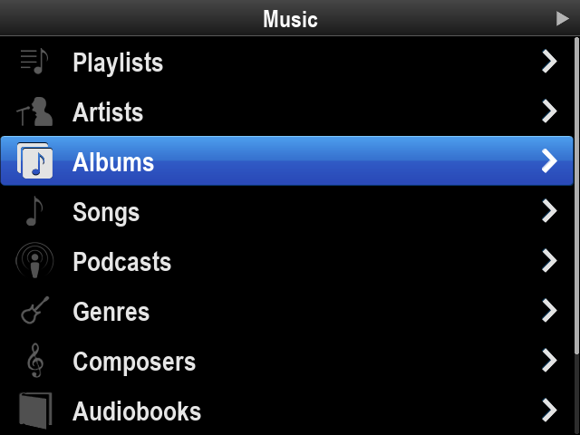
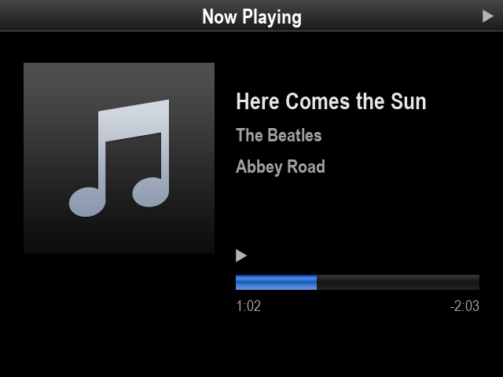

# pyPodOut

A recreation of the iOS **iPod Out** feature, the iPod-style interface that iPhones sent to car head units over analog video, written in Python with pygame.

It renders a 640x480 iPod menu using the original artwork, extracted into `res/`. You navigate with the keyboard, and a horizontal slide plays when you move between screens.

| Menu | Now Playing |
| --- | --- |
|  |  |

## Running on a desktop

Requires Python 3 and pygame 2.

```bash
pip install pygame
python main.py
```

| Key | Action |
| --- | --- |
| Up / Down | Move the selection |
| Enter | Open the selected item |
| Esc / Backspace | Go back |
| Space | Play / pause (on Now Playing) |

Set `FULLSCREEN=1` to fill the display. The picture is scaled with its 4:3 aspect ratio kept, and the mouse cursor is hidden.

## Project layout

```
main.py                  entry point: builds the menus, runs the event/draw loop
podout/config.py         screen size, layout and timing constants
podout/playback.py       shared playback state
podout/resources.py      cached image/font loading from res/
podout/events.py         custom pygame events (screen push/pop, menu selection)
podout/ui/screen.py      UIScreen base class + ScreenManager (screen stack, transitions)
podout/ui/menu.py        UIMenu / UIMenuItem
podout/ui/now_playing.py UINowPlaying
podout/ui/status_bar.py  UIStatusBar (title + play state)
podout/ui/transition.py  horizontal slide transition
deploy/podout.service    systemd unit for the Raspberry Pi
```

## Running on a Raspberry Pi without a desktop

On Raspberry Pi OS Lite, SDL draws straight to the screen through the kernel's display driver (`kmsdrm`), so no desktop is needed. These steps were worked out on a Pi 3 with a composite video display.

1. **Install pygame from apt.** The pip wheels likely lack the `kmsdrm` driver. Also install the Mesa graphics libraries:
   ```bash
   sudo apt install python3-pygame libegl1 libegl-mesa0 libgles2 libgbm1 libgl1-mesa-dri
   ```
2. **Give your user access to the display, GPU and keyboard:**
   ```bash
   sudo usermod -aG video,render,input $USER   # log out and back in
   ```
3. **Enable the KMS display driver.** `/boot/firmware/config.txt` should contain the line below; add `,composite` if the composite output is missing:
   ```
   dtoverlay=vc4-kms-v3d
   ```
4. **Composite only: force the output on.** Composite can't report whether a screen is attached, so SDL ignores it ("kmsdrm not available"). Add this to the end of the single line in `/boot/firmware/cmdline.txt`, then reboot:
   ```
   video=Composite-1:720x480@60ie,tv_mode=NTSC
   ```
   For PAL, use `720x576@50ie,tv_mode=PAL`. Check with
   `for f in /sys/class/drm/card*-*; do echo "$(basename $f): $(cat $f/status)"; done`, which should show `Composite-1: connected`.
5. **Run it:**
   ```bash
   SDL_VIDEODRIVER=kmsdrm SDL_RENDER_DRIVER=opengles2 FULLSCREEN=1 python3 main.py
   ```
   `SDL_RENDER_DRIVER=opengles2` avoids an "EGL not initialized" error.
6. **Start at boot (optional).** Edit `User` and `WorkingDirectory` in `deploy/podout.service`, then:
   ```bash
   sudo cp deploy/podout.service /etc/systemd/system/
   sudo systemctl daemon-reload
   sudo systemctl enable --now podout
   ```

## Credits

The interface artwork in `res/` was extracted from iOS and belongs to Apple. This project is an unofficial fan recreation.
